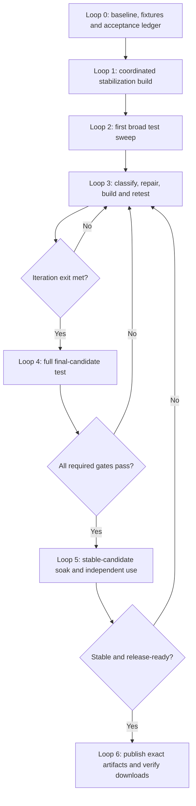

# Aggressive preview-first execution: build, test, repair, certify

Date: 2026-09-05. Status: detailed execution proposal under the owner's frozen [preview-first release plan](2026-09-05-preview-first-and-route-comparison.md). Scope and quality gates are unchanged. No implementation, workflow dispatch or publication has started under this document.

## Outcome and execution shape

Produce one coordinated stabilization build containing the known launch fixes and critical current Apps work. Test the entire supported preview surface against that build. Repair failures in small, traceable batches and retest affected behavior. Once those loops converge, run a comprehensive final test on an immutable release candidate, complete the stable-candidate soak, then publish the verified artifacts.

“Big build” means one integrated feature-frozen stabilization candidate, not one opaque commit. Keep coherent fixes reviewable, integrate them into a single release worktree, and freeze each test candidate. Do not run the whole release matrix after every small edit. Focused bug reproductions, necessary regression checks and compilation during development still apply; the broad product sweep begins after the coordinated build.

## Schedule assumptions and checkpoint

**Aggressive target: 5–7 days from a ready execution start; use day 7 as the practical target.** Five days requires the first build to converge early, limited repair work and the minimum 24-hour soak. A 48-hour soak and another repair cycle generally push toward day 7 or beyond. These are scheduling assumptions, not measured future coding-agent throughput.

This requires three experienced implementation owners using coding agents, an independent test/release reviewer, and an available maintainer for decisions and publication. It is not the estimate for one serial agent session. The normal 8–12 working-day plan remains the fallback when staffing, test infrastructure, auth complexity or recovery defects exceed the aggressive assumptions.

| Loop | Target window | Time budget / checkpoint |
|---|---|---|
| 0. Baseline and fixtures | Start of day 1 | 2–4 working hours; fixture preparation can continue alongside independent fixes |
| 1. Coordinated stabilization build | Days 1–3 | Target two days of implementation plus integration capacity; complete by end of day 3 |
| 2. First broad sweep | Day 3–4 | 6–10 working hours with independent test groups running concurrently |
| 3. Repair/build/retest | Day 4–5 | Reserve 6–12 working hours, normally 2–3 bounded iterations; repeat as needed |
| 4. Full final-candidate test | Day 5 | 4–8 working hours after the iteration exit is satisfied |
| 5. Soak and independent use | Day 5–7 | 24–48 actual elapsed hours on the final candidate |
| 6. Release and verification | Day 6–7 | 2–4 working hours after all gates pass |

The windows overlap and are targets, not durations to add mechanically. Human work is budgeted in working hours; the soak runs continuously, including overnight. Test-runner and CI capacity must permit the stated concurrency.

**Checkpoint:** if the complete stabilization build is not ready by end of day 3, or the first broad sweep exposes a new consequential auth/data/upgrade design, revise toward the normal 8–12-day plan. Record the cause and remaining estimate. Do not shorten the soak, skip a matrix row, or silently remove Apps to preserve the aggressive date.

## Ownership and safe concurrency

| Owner | Initial build responsibility | During repair loops |
|---|---|---|
| Product owner | Notes, request retry behavior, login flow, protected images, editor compatibility and mobile layouts | Client persistence, rendering, accessibility and real user journeys |
| Backend/Apps owner | Session/OAuth fixes, conditional native GitHub state handling, automation visibility/eligibility, actual scheduled-effect path | Authorization, Apps, queue/worker and idempotency failures |
| Operations owner | Download assets, upgrade recovery, process supervision, backup/restore, public authoring artifacts and release packaging | Install, migration, restart, restore and image/config failures |
| Independent reviewer | Failure fixtures, acceptance matrix, security review, real-browser/DB tests, evidence and release checklist | Classify failures, independently verify fixes and guard candidate identity |

One designated owner controls shared schemas, migrations, package/lockfile changes and integration. Product and backend owners coordinate auth/client changes before integration. These are proposed roles; this planning task does not spawn agents, start tasks, or assume people are already assigned.

## Loop 0 — Make the build and test target unambiguous

Inputs: the frozen preview scope, [launch findings L01–L12](../audits/2026-09-05-launch-readiness-roadmap.md), [Apps findings](../audits/2026-09-05-app-platform-track-a-status.md), and current repository instructions.

- [ ] Refresh the actual master and PR states. The audited `7355c90a` is a reference, not an instruction to ignore later work. Preserve the stale root checkout's edits and all unrelated worktrees.
- [ ] Create an isolated release worktree and identify the candidate integration branch. Incorporate already reviewed fixes deliberately; do not develop in the archived audit snapshot.
- [ ] Create one acceptance ledger with IDs, release profile, severity, owner, reproduction, expected result, regression test, source/image identity and evidence link.
- [ ] Inventory the actual routes/screens, scripts and existing tests for the frozen supported features. Map every offered feature to at least one successful journey, authorization boundary and applicable failure/recovery path.
- [ ] Prepare a disposable Linux Docker/pgvector host with matching repository runtimes, synthetic fixtures, separate test DBs/volumes and browser support. No tests reset or seed existing user/customer data.
- [ ] Create two organizations; owner/admin/member/guest and second-user fixtures; public-authoring directories outside the monorepo; a separate deterministic provider using the real transport; test keyrings and receipt verification.
- [ ] Freeze default and Apps-enabled image profiles, their build/runtime flags, the supported upgrade predecessors and the capacity test dataset.
- [ ] Assign ownership of every offered surface and required check; reserve independent tester time and release review before the deadline.

Exit: an isolated development base, runnable test infrastructure and a finite test matrix with owners. Infrastructure problems are recorded as unavailable evidence, never as passing tests.

## Loop 1 — One big stabilization build

Complete the following in a coordinated batch. Reproduce the exact symptom before a behavioral fix; static audit findings require confirmation. Consult the installed Next.js documentation before relying on framework behavior. Make the smallest adequate fix, with a regression scenario crossing the real service/client seam.

| Build item | Required behavior | Minimum development check |
|---|---|---|
| L01 Notes saves | Body/title/icon edits converge; Saved reflects successful persistence; failed saves retain dirty state | Reproduce body-then-title and HTTP 500; assert saved payload and reload |
| L02 request retries | Lost response after a committed write cannot duplicate the effect | Inject response loss and count durable writes; retain safe read retries |
| L09 login | Wrong then correct password succeeds; return URLs are safe | Browser login sequence and redirect-negative checks |
| L10 images | Protected Notes images load only for authorized users | Authorized image/reload and second-user denial; no token stored in document |
| L06 editor dependencies | Coordinated TipTap update removes vulnerable transitive paths without mixed core types | Fresh dependency audit, typecheck and editor persistence/media regression |
| L07 auth/OAuth | Rotation, revocation, malformed inputs and public-endpoint abuse handling work | Session reuse/concurrency/logout and legitimate MCP auth cases; independent boundary review |
| L08 unsupported native GitHub | Unbound linking state is not reachable in the offered preview | Verify the unsupported route is unavailable; if retained, fully test expiring one-use session/user/org binding |
| L03 release assets | Empty-directory install needs no undeclared checkout files | Construct the release-file bundle and perform a fresh-volume smoke |
| L04 upgrade failure | Previous code only restarts when schema-compatible; explicit recovery otherwise | Faults before/after schema changes and during restart |
| L05 process lifecycle | API/web death changes container health/lifecycle correctly; jobs recover | Kill each process separately and verify termination/recovery |
| L11 recovery | DB/files/config/keyrings/image identities are recoverable from public instructions | Exercise clean-target restore and receipt/key verification |
| L12 Apps mobile | Integrate #317 or its current reviewed equivalent | Inspect 320px/390px/desktop; assert nested and document width |
| A-PAGE | Active schedules stay visible beyond 50 definitions | Old active schedule remains reachable and pausable on later pages |
| A-STATE | Expired/stale/blocked schedule status and failure reasons are truthful | Validity, changed resource, revoked grant/member and disabled provider cases |
| A-RESULT | Operator can identify the Run/receipt and safe dead-letter recovery path | Trace a scheduled result; confirm no blind retry of ambiguous effects |
| A-EFFECT | Actual due fire produces exactly the intended provider effect | Production scanner → queue → worker → Run → sandbox provider → result/receipt |
| A-RECOVERY | Duplicate delivery/restart/restore/revoke cannot create unintended effects | Count external effects and verify durable fire/Run identity |
| A-COST | Bounded management/scan behavior at preview scale | Measure paginated query/scan behavior; fix demonstrated starvation or load defects |
| U-PUBLIC | Exact kit/reference artifacts and a usable authoring/install guide exist | Clean outside-repository build/stage journey using only the proposed public files |

During this loop, implement the candidate and prepare focused regressions. The reviewer prepares the broad matrix independently, reducing the chance that tests only repeat implementation assumptions. Necessary local checks catch broken imports, failed repros and unsafe migrations before integration; full browser/load/recovery certification is reserved for later loops.

Artifacts may be staged locally or in an authorized candidate channel while preparing the release. Final publication and the announcement occur in Loop 6. Do not document unpublished npm commands as already working.

### Build freeze B1

When the owners finish their patches, integrate them in dependency order and build the complete API/web image plus App Kit artifacts. Freeze a candidate label `B1` with:

- source commit, dependency lock digest and migration ledger;
- exact image digest and web-build flags for each offered image/profile;
- exact App Kit/reference package digests;
- configuration profile identifiers, without secrets;
- list of included fixes, remaining known findings and focused regression outcomes.

Exit: every Loop 1 item is implemented or factually resolved, focused checks pass, and B1 boots in the isolated environment. All three owners review the integrated diff. **B1 is testable, not release-certified.** No B/C/D feature work enters this build.

## Loop 2 — First big test: discover everything broken in the supported preview

Run the following on frozen B1. Use separate fixture tenants/DBs/volumes so parallel test groups cannot erase each other's evidence. Within a journey, keep dependent actions ordered. Preserve logs, screenshots, durable IDs and receipt/effect counts before cleanup.

| Group | Required test coverage | Assertions beyond a successful response |
|---|---|---|
| T01 source/build/contracts | Supported typecheck, lint, API/web build, shared/App Kit/API/web suites, package and migration conformance | Zero unresolved required failures; skips explicitly reviewed |
| T02 account/onboarding | Fresh signup, no-AI workspace, wrong/right login, refresh, logout/revoke, invite acceptance and role changes | Session and destination correct; revoked authority cannot continue |
| T03 chat/tasks | Messages and attachments; task create/update/assign/status/date; relevant views and realtime reconnect | Persistence after reload; no duplicates; other user sees only authorized updates |
| T04 Notes/media | Rapid edits, title/icon changes, rich content round-trip, failed save/offline/reconnect, image upload/read | Latest acknowledged data retained; unsaved state honest; unauthorized file access denied |
| T05 knowledge/calendar/settings | Supported ingestion/search/context/citations, calendar/event flows, provider/settings changes | Fresh authorization on retrieval; lost responses do not duplicate calendar writes |
| T06 agents/MCP/Hermes | Current supported release scenarios; real client read/write, approval/denial, result/receipt, scope revoke, offline provider | Governed effect and verifiable receipt; denied/revoked actions cause zero effect |
| T07 Modules/Apps lifecycle | Build, inspect, pair/stage, review grants/bindings, activate, relate/query records, upgrade, disable and dependency failure | Requested authority never self-activates; lifecycle and records survive upgrade |
| T08 automation | Actual due fire; DST/misfire/resume; budgets; duplicates; lease expiry; stale pins; membership/grant/App/provider revocation; dead letters | Exact effect count, unique fire/Run, receipt identity, no unsafe retry |
| T09 security/tenant/privacy | Two orgs and varied roles across offered routes; token/session/input abuse; protected files, search, logs and receipts | No cross-tenant/private content exposure, secret leakage or authority escalation |
| T10 installation | Empty-directory public-file install with fresh volumes; default and Apps opt-in profiles | No hidden checkout dependency; flags/keyrings consistent; healthy usable service |
| T11 upgrade/restore | Latest published preview and supported baseline upgrades; backup and clean-host restore; interrupted upgrade | DB/files/config/keys preserved; compatible restart or successful explicit recovery |
| T12 process/provider failure | Kill API/web/worker; queue outage; provider timeout; ambiguous result; reconnect | Correct process supervision, bounded recovery, no duplicate external effect |
| T13 rendered/accessibility | Chromium desktop/mobile; critical Firefox/WebKit journeys; 320px/390px/desktop; keyboard and screen-reader essentials | Usable focus/labels/errors; no clipped nested content; actual interaction succeeds |
| T14 capacity | Fixed hardware/dataset, 60 synthetic users, representative concurrency, >100 definitions and historical pages | Measured latency/query/queue budgets, tenant fairness, no unbounded growth |
| T15 public instructions | Independent tester obtains exact candidate files and builds/stages a supported App outside the repo | No private import, hidden credentials, undocumented manual glue or false feature claim |

T03–T06 are expanded by Loop 0's actual feature inventory; the table is a coverage index, not a reason to omit another offered screen or workflow. “Test everything” means all required inventory rows and relevant boundaries, not an impossible claim that every input permutation has been explored.

Start source/contract and boot checks first, then run independent functional/security/operations groups concurrently. If a shared failure blocks a whole group, record every blocked row and repair that cause; do not report the blocked journeys as tested. Continue unaffected groups so the sweep remains productive.

Output: one B1 results ledger. Each failure contains a minimal reproduction, expected/actual behavior, affected profile, source/image identity, evidence, owner and severity. Mark **failed**, **blocked**, **flaky/unresolved**, **passed**, or **not applicable with reason**. Never collapse unavailable evidence into passed.

## Loop 3 — Iterative repair builds and targeted retests

Repeat this loop until its exit conditions hold. The 6–12-hour budget is a forecast, not a limit on fixing release blockers.

### One iteration, normally 2–4 working hours

1. **Classify, 15–30 minutes.** Separate product defects, fixture/test bugs, infrastructure failures and proposed scope changes. Group failures by root cause. Assign one owner to each shared cause.
2. **Reproduce and repair, usually 1–2 hours for a bounded defect.** Preserve a failing regression, make the smallest fix and inspect the diff. Larger fixes get a revised estimate; do not squeeze an auth redesign into a two-hour target.
3. **Build a new candidate.** Freeze `B2`, `B3`, etc. with source/image/package identities and a precise delta from the last tested build. Do not mutate the deployment during a test group.
4. **Retest the failure and its affected boundaries, usually 30–90 minutes.** Run the original reproduction plus adjacent success/negative/compatibility cases. Verify it did not merely disappear because the fixture or feature was disabled.
5. **Independent verification, 15–30 minutes.** Reviewer checks behavior and evidence, updates ledger and opens any new regression. Classify unchanged prior evidence explicitly; it is not a fresh pass on the new candidate.

Fix order:

- **S0:** data loss, tenant/auth compromise, duplicate external effect, unsafe schema recovery. Stop affected feature testing/usage until isolated and repaired.
- **S1:** installation/login/core workflow failure, broken permissions or offered Apps/automation operation. Must close before final certification.
- **S2:** offered UI/accessibility/state/reporting defects and significant measured performance failures. Close those affecting ordinary use; only nonessential polish may be explicitly deferred under the frozen scope rules.
- **S3:** optional enhancements outside the frozen release. Keep them out of the release branch.

The pre-existing L01–L12 obligations remain mandatory regardless of whether this operational severity scheme labels a particular issue S1 or S2.

### Retest impact map

| Changed area | Minimum affected retests |
|---|---|
| API client / retries | Notes, tasks, calendar writes, login/auth interception, lost-response and idempotency cases |
| Session/OAuth / middleware | Login/refresh/logout, MCP auth, org/role denial, pairing, protected files and shared auth-dependent routes |
| TipTap / editor | Notes serialization/persistence, rapid saves, images, clipboard and browser differences; types/build/audit |
| Apps / Run / queue / authorization | Lifecycle, real scheduled effect, duplicate/revoke/budget/unknown outcome, receipts, restart/restore |
| Schema / migration | Fresh parity, all affected service DB tests, every supported predecessor upgrade, failure recovery and restore |
| Docker / entrypoint / release assets | Fresh install, both configuration profiles, process death, upgrade/restore and downloaded-file smoke |
| CSS / component | Changed rendered journey, mobile/desktop/keyboard, nested overflow and shared layout consumers |
| Docs / public packages | Exact commands on a clean root, package hashes/version compatibility and outside-repo staging |

Do not repeatedly rerun expensive unrelated suites during these loops. If the impact is unclear or crosses several shared boundaries, broaden the retest deliberately. A test-harness fix requires rerunning the behavior that the faulty assertion failed to observe; the earlier false pass remains invalid.

### Iteration exit

- All mandatory defects and S0/S1 findings are closed with independently checked regressions.
- All required T01–T15 rows have executed at least once or have an explicit, valid applicability decision; none is blocked by missing infrastructure.
- Every repair passes its impact map; no unresolved flake masks a required scenario.
- The current candidate includes all intended changes and no new feature expansion.
- Any permitted minor deferral is documented with user impact; source diff, migrations and dependencies are reviewed.

This exit permits the final big test. It does not itself permit release.

## Loop 4 — Second big test: certify the final candidate

Freeze `RC1`, including the intended release version and all version-dependent files before its artifact build. Rebuild/reuse artifacts according to content identity, recording the exact source, image, packages, flags and migrations. Verify the certification workflow is actually configured to consume RC1 rather than the old Track A candidate pin.

On clean isolated test data, run the **entire required T01–T15 matrix again on RC1**, including the existing full applicable repository suites and all new regressions. Use the same immutable artifact for browser, default/opt-in operation, install, supported upgrades, failure injection and restore wherever the offered image profile permits; separately identify any profile that requires a different build.

Also verify:

- current security/dependency scans and independent review findings are closed;
- unknown-outcome, tenant denial and provider effect counts are correct, not inferred from aggregate Run counts;
- the documented backups restore DB, uploads and referenced keys, and receipts verify afterward;
- release files are self-contained, flags match the advertised product and the operator stop/recovery path works;
- no required test was silently skipped and no source changed while a group was running.

Exit: all required RC1 tests pass with evidence linked to RC1. Any product change after failure creates a new candidate, returns to Loop 3, and then requires another final matrix on the corrected candidate. Do not assemble a final certificate from passes on different source revisions.

## Loop 5 — Stable soak and independent use

Run RC1 unchanged for **at least 24 elapsed hours**, targeting 48 when the aggressive window allows. The default profile and offered Apps profile need representative sustained operation; separate images receive separate evidence. Provision enough capacity to run them concurrently rather than omitting one.

Exercise normal work, reconnect, scheduled actions, provider downtime and controlled restart. Track failures, unexpected duplicate effects, queue lag/recovery, memory/connections, persistence and receipt checks. Use deterministic clock tests for time boundaries and actual due schedules for the real worker path; do not simulate the passage of 24 hours and call that a 24-hour soak.

Have 3–5 independent testers, including someone outside the implementation work, follow the candidate instructions on disposable installs. Test no-AI setup, an ordinary workspace journey, an App install and the documented recovery procedure. Obtain sanitized reports only.

Start the soak after the final matrix passes; public documentation editing outside the product artifact can continue independently. A functional/security/runtime fix invalidates affected soak evidence and sends the candidate back through repair and final certification. Pure external release-note wording changes do not invalidate an unchanged image, but its instructions must be rechecked.

Exit: stable-candidate evidence, independent usability results and all frozen release conditions pass. Lack of tester availability or a stopped soak is missing evidence, not automatic completion.

## Loop 6 — Release the tested build

- [ ] Review the final ledger and known limits; confirm the release identity frozen in RC1 without confusing migration IDs with package release versions. Do not introduce a late version-file change after certification.
- [ ] Publish/promote the certified image and exact kit/reference artifacts, preserving verified identities. If release tooling rebuilds the image, treat a different digest as a new candidate and certify it; do not assume reproducibility.
- [ ] Publish matching source, checksums, provenance/SBOM where supported, configuration files and installation/upgrade/recovery instructions. Retain durable evidence beyond CI artifact expiry.
- [ ] Pull the published digest and download the public files into a clean environment; repeat install/login/core persistence/Apps smoke and verify their identities match RC1.
- [ ] If publication or download verification fails, correct it before the broad announcement. Never silently replace an immutable release artifact.
- [ ] Assign first-week support/hotfix ownership and rehearse the operator disable/recovery steps. Then announce the bounded preview.

Publication and external announcements remain deliberate execution actions after a concrete candidate is reviewable. This plan creates no automation or external message.

## Progress record after every loop

Report: current candidate and scope; completed fixes; T01–T15 results with evidence; failures by severity/root cause; blocked requirements; the next loop; actual hours used; and revised remaining time. Show passed/total required scenarios and explain denominator changes. Do not use raw passing-test counts as a substitute for missing journeys.

The exact next step is Loop 0, then the coordinated Loop 1 build. Tracks B/C/D and remaining broad Gate G work remain after the first preview. The aggressive plan changes batching and staffing, not the product scope or release quality bar.
