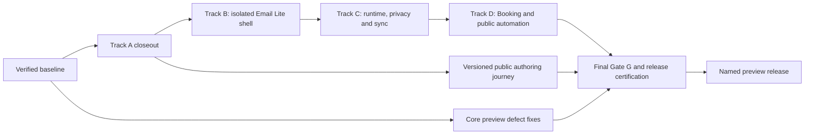

# Deft: complete Tracks A–D, close Gate G, and ship the public preview

Date: 2026-09-05. Status: **Post-preview continuation reference.** The owner selected and froze the [preview-first plan](2026-09-05-preview-first-and-route-comparison.md) on 2026-09-05; that plan controls the next release. Implementation has not started under this plan.

The original full-platform-first sequence and estimates below are retained for reference. Complete the selected preview stabilization first, reuse its completed fixes and evidence, then rebaseline remaining B/C/D and Gate G work. These later tracks are not prerequisites for the first preview, and the 6–8-week estimate below is not its active launch estimate.

## Outcome

Ship a named, recoverable self-hosted preview containing the completed bounded automation plane, isolated custom App experiences, operator-managed App runtimes and one-way specialized sync, and a governed Public Gateway. Close the applicable Gate G requirements and every defect identified in the September 5 launch and Apps audits. Prove the platform with independently packaged Email Lite and Booking Apps, current public authoring instructions, and the exact release image.

“Final shape for preview” means the measurable release criteria below pass. It cannot mean a promise that no undiscovered bugs exist. No known critical/high security issue, data-loss defect, authority bypass, duplicate-effect defect, broken supported install/restore path, or failed required scenario may remain in the supported preview scope.

This plan is based on inspected master `7355c90a`, the passed Track A certificate, open PR #317, the unmerged Email Lite proposal `9e244ff4`, and these reports:

- [Launch audit and L01–L12 findings](../audits/2026-09-05-launch-readiness-roadmap.md)
- [Apps / Track A implementation and evidence review](../audits/2026-09-05-app-platform-track-a-status.md)
- [Frontend evidence](../audits/2026-09-05-launch-frontend-product.md)
- [Operations and worktree evidence](../audits/2026-09-05-launch-release-ops.md)
- [Security evidence](../audits/2026-09-05-launch-backend-security.md)

The root checkout is 157 commits behind that audited master. The first execution step must establish a current integration base while preserving its existing edits and all unrelated worktree changes. The archive under `tmp/launch-audit-2026-09-05/current` is evidence, not the development branch.

## Time estimate and assumptions

These are engineering planning estimates, not measurements of Codex's future execution speed. An implementation day means a productive working day including review and focused validation. Calendar duration includes overlapping work and explicit stabilization time; person-days must not be confused with elapsed days.

**Recommended planning allowance: 30–40 working days, approximately 6–8 working weeks.** Best case: approximately 22–25 working days, or 4–5 weeks, if the architecture spikes pass promptly and little rework is needed. Allow 9–12 weeks if isolation, private-resource authorization, synchronization recovery, or external review exposes a redesign. A single serial implementer/agent loop should budget roughly 10–14 weeks rather than assuming the parallel estimate applies.

Assumptions for the 6–8 week plan:

- Two experienced implementers assisted by coding agents, plus a dedicated test/release reviewer who can independently inspect security-sensitive work. Agents can accelerate implementation, but do not remove integration, external validation, and review time.
- One person owns shared contracts, schemas and migrations; conflicting edits do not run concurrently.
- A disposable Linux Docker/pgvector environment and adequate CI capacity are available on day one. They were not available for fresh local release-host tests during the audit.
- A domain/TLS test environment, operator-owned test runtime, synthetic mailbox/provider, registry or public-release artifact access, and daily owner decisions are available without long waits.
- The scope is the minimum independently proven A/B/C/D platform. Email Lite is a bounded reference App using a deterministic provider and one IMAP/SMTP test adapter. Booking uses Deft-canonical slots first.
- Single-instance self-hosted linux/amd64 remains the supported deployment target. Multiple worker claims must be safe, but this does not promise a multi-replica SaaS fleet.

| Work package | Implementer effort | Typical elapsed time with the assumed staffing | Dependency |
|---|---:|---:|---|
| 0. Baseline, fixtures and ownership | 1–2 person-days | 0.5–1 day | Start |
| A. Close Track A and certify actual scheduled completion | 3–5 person-days | 2–3 days | 0 |
| P. Core preview fixes L01–L11 | 7–10 person-days | 6–9 days, alongside Apps work | 0; release blockers fixed before affected support is claimed |
| B. Isolation decision, Experience Host, SDK, Email Lite shell | 7–10 person-days | 4–6 days | A exit |
| C1. Operator runtime kernel | 5–7 person-days | 3–4 days | B exit |
| C2. Private resources, capabilities and one-way sync | 7–10 person-days | 3–5 days | C1 and frozen consumed Gate G contracts |
| C3. Compound Email Lite proof | 2–3 person-days | 1 day | B + C2 exits |
| D. Public Gateway and Booking proof | 7–10 person-days | 4–6 days | C exit under this chosen sequence |
| U. Public App Kit and authoring experience | 2–3 person-days | 2–3 days, spread across the tracks | Version-matched public artifacts |
| G. Final conformance, performance, security, restore, soak and release | 6–9 person-days | 4–6 days | A–D + P + U exits |

The sequential platform path is approximately 22–32 working days before unplanned rework. Reserve another 5–8 days of schedule capacity for integration and defect correction; use **30–40 days** for planning. Estimated implementation effort is approximately 47–69 person-days, plus reviewer effort. These ranges are correlated: adding staff does not divide the critical path linearly.

Re-estimate after the B isolation spike and after C's first restore/resync test. Track C carries the greatest uncertainty. Record actual throughput and remaining work rather than promising the original date after a failed gate.

## Fastest adequate architecture

| Choice | Speed and tradeoff | Decision |
|---|---|---|
| One evolving Email Lite proof for B/C, then Booking for D | Reuses App, runtime, synthetic data and evidence harness while preserving distinct certificates | Recommended |
| Separate custom-UI console, separate runtime demo, then Email Lite | More scaffolding and duplicated lifecycle/browser tests; useful only if Email Lite cannot exercise an isolated plane | Fallback only |
| Merge UI, runtime, sync and public ingress together | Fast-looking first diff, but interdependent failures, migration coupling and proof gaps delay reliable release | Reject |

Preserve the existing path: caller → Resource/AppAction service → live host authorization and grants → App Run/attempt → provider/runtime → result and receipt. Scheduled and public callers get distinct, bounded principals; custom UI receives no reusable workspace authority. Runtime callbacks cannot substitute their own result, tenant or Run identity. Apps request capabilities; the host binds provider, policy and credentials.

Keep current v0/v1/v2 package bytes and behavior frozen. The existing proposal's v3 experiences, v4 runtime/sync and ResourceRef v2 are candidate additive version boundaries; freeze the exact versions and schemas only after the relevant architecture decision and executable spike. Public ingress requires its own reviewed additive contract/version decision. Do not add undeclared fields to an existing released version.

Every persistent object needs a production writer, bounded reader, authorization/revocation path, retention owner, migration and recovery proof. Avoid unused registries, a second scheduler, a workflow language, or a second execution ledger.

Gate G dependencies are implemented inside B/C/D where first consumed. The final G box is their combined verification and remaining stabilization, not permission to postpone required privacy or authorization work.

## Execution organization

- **Platform owner:** shared contracts, authorization, database, runtime and sync decisions. One writer owns these shared seams at a time.
- **Product/operations owner:** core defects, authoring, App UI, release packaging and operator journeys; joins platform work once the independent stabilization backlog is under control.
- **Reviewer:** adversarial fixtures, database/browser proof, artifact identity, independent boundary review and defect triage. Tests cross the same public service seams as production callers.

These are staffing roles for execution, not agents started by this planning task. Use isolated worktrees and short-lived `codex/` branches. Reconcile the unmerged Email Lite plan rather than blindly merging its old base. Inspect the pre-existing modified Hermes worktree for relevant fixes and regressions; do not fold unrelated experimental work into the release by default.

Use one structural and one behavioral PR only where separate rollback/review boundaries help. A manifest feature includes its parser, persistence, review, enforcement, revocation, App Kit and conformance together. Do not create a PR for every checkbox. Do not begin another privileged plane before the preceding plane has its required independent proof; core fixes and public documentation may proceed independently.

## 0 — Establish a reproducible baseline

- [ ] Verify current remote/PR state; choose the integration base and preserve original local changes.
- [ ] Create one acceptance ledger covering L01–L12, A01–A07 below, B/C/D requirements, Gate G, open issues and new defects. Each row has an owner, affected release claim, reproduction, patch and evidence link.
- [ ] Provision an isolated Linux test host with the repository-supported Node/pnpm versions, real pgvector, private fixture data and disposable volumes. Never use the user's existing DB for reset/seed tests.
- [ ] Create reusable external App roots, synthetic provider/runtime, two organizations, owner/admin/member/guest identities, deterministic clock fixtures and receipt verification helpers.
- [ ] Record baseline typecheck, focused contracts, install/upgrade smoke and current performance. Existing audit passes can guide this; they do not certify future changes.

Exit: one reproducible command/environment for focused DB tests and one for release-host certification, with no implicit local secret or file dependencies.

## A — Finish Track A properly

The old certificate remains historical evidence. This phase addresses the concrete gaps found after it, rather than rebuilding the scheduler.

| ID | Required change | Completion evidence |
|---|---|---|
| A01 | Integrate the reviewed #317 mobile fix | Desktop and 390px/320px management proof; document and nested-scroll width checks; keyboard access |
| A02 | Make all active schedules discoverable | Cursor pagination with stable ordering; more than 50 historical definitions cannot hide an old active schedule; pause works from later pages |
| A03 | Expose effective state, expiry and blocked reasons | Validity window, next fire, last failure reason, paused/revoked/expired state, stale pins, connector/grant/member failures and Run/receipt drilldown |
| A04 | Finish permanent revoke and renewal UX | Tenant-scoped expected-epoch revoke; no stale queued dispatch; renewal is a freshly reviewed definition; replaced work cannot run twice |
| A05 | Keep retry semantics safe and explicit | Dead-letter diagnosis and reviewed replacement; add same-fire retry only if existing Run policy proves it safe; unknown outcomes never create a blind second send |
| A06 | Remove avoidable management query fan-out and measure scan cost | Bounded query count per page; no tenant starvation; 30-day history and >100-definition scanner pages tested |
| A07 | Prove the complete production path | Actual due scan → queue → automation Run → sandbox-provider effect → terminal result → verified receipt, including restart/restore |

Tests: DST fold/gap, timezone aliases, 15-minute boundary, pause/resume with no backfill, duplicate scan, simultaneous claims, exhausted budget, queue loss, expired lease, provider offline, record mutation, grant/member/connector/App revocation before claim and before provider dispatch, attempt exhaustion and ambiguous outcome.

Release-image proof must assert exactly one provider effect for each successful logical fire, zero for denied fires, and safe replay after database+keyring restore. A future-dated schedule visible in the browser is insufficient. Add a changed-source/candidate-pin guard so a new gate cannot accidentally certify the old `121aa7c0` image.

Exit: A01–A07 closed, fresh certificate linked to exact source/image, operator instructions correct. The schedule remains bounded daily automation; broad capability generalization occurs in C/G dependencies below.

## P — Fix the whole-preview defects in parallel

Every confirmed L01–L12 issue is in scope. Reproduce each static finding before changing it; narrow the defect if the initial hypothesis does not hold.

| Findings | Work | Required regression |
|---|---|---|
| L01 | Preserve Notes dirty body state across title/icon saves; show Saved only after success | Type body then title/icon; failed PATCH, offline/reconnect, rapid edits and reload; latest intended content persists |
| L02 | Make client retries respect idempotency and unknown outcomes | Server commits but response is lost; no duplicate event/task or external write; safe read retries still work |
| L03 | Make release downloads self-contained | Empty-directory download-only install; fresh volumes; no checkout-relative SQL dependency |
| L04 | Repair upgrade failure recovery | Fail before schema change, after change and during app start; old code only restarts when compatible; restore path succeeds otherwise |
| L05 | Supervise API and web lifecycle | Kill either process; container fails/restarts correctly; leased work is recovered without duplicate effects |
| L06 | Repair the coordinated TipTap graph, including PR318 | Vulnerable direct/transitive paths removed; types/build pass; Notes/editor round-trip and image regressions pass |
| L07 | Close refresh-session/revocation and public OAuth input/limit gaps | Rotation, concurrent refresh, reuse/revocation, logout, malformed bodies, abuse ceilings and valid MCP login flows |
| L08 | Disable unsupported native GitHub linking in this preview, or fully fix and prove it if retained | No reachable unbound state path; if enabled, state bound to session/user/org, expiring and one-use |
| L09 | Repair wrong-password → correct-password flow and redirect validation | Auth errors stay local; successful login lands correctly; unsafe return destinations rejected |
| L10 | Load protected Notes images through authorized file access | Owner sees valid media; unauthorized users fail; no bearer token persisted in document/URL |
| L11 | Supply executable backup/restore instructions | Preserve DB, uploads, config, keyrings and image identity; clean-host restore recovers records, files and verifiable receipts |
| L12 | Covered by A01 | Final Apps-enabled image passes nested mobile overflow proof |

Fix auth/duplicate-effect failures before claiming the dependent unattended or public surfaces are supported. Complete the focused independent security review of changed auth, file and connector boundaries.

## B — Isolated custom experiences using Email Lite 0.1

### B0: decide isolation before the manifest

Compare an opaque-origin iframe with a separate cookie-less origin per installation/version. Choose the smallest model that passes ordinary self-hosting, immutable module loading and isolation tests. Do not freeze the bridge or asset contract until this works with the installed Next.js documentation and real browsers.

Prototype denials for cookie access, parent DOM, cross-App storage, top navigation, popups, service workers, network primitives, malicious HTML and stale frames. Explicitly decide download/file-picker behavior, browser storage quota/clearing and asset MIME handling. If neither model passes, re-estimate B rather than enabling a leaky workaround.

### B1: implement one complete supported surface

- [ ] Immutable, content-addressed static assets; bounded file count/size/total size, digest verification and MIME allowlist. No App build scripts run in Deft.
- [ ] Additive package/manifest and review diffs; safe install/upgrade/disable and retained-artifact cleanup.
- [ ] Closed MessageChannel bridge tied to frame, nonce, organization, user, installation/version and live epochs; reject replay, excessive payloads and unknown messages.
- [ ] Public experience SDK for the bounded resource/action/Run/navigation/theme/dialog features the proof consumes. File access is brokered and authorized.
- [ ] Independently packaged Email Lite shell using existing resources and governed actions; no mailbox runtime or domain-specific backend shortcut yet.
- [ ] App Kit check/build/doctor, template, simulator and version-matched author guide.

Exit: independent external App passes normal and hostile desktop/mobile/keyboard journeys, live revoke/upgrade, no ambient credentials or egress escape, exact-image fresh/upgrade/restore and cleanup. B gets its own evidence record before runtime authority becomes supported.

## C — Operator runtimes, private capabilities and specialized sync

### C1: runtime kernel

- [ ] Operator-only registration, explicit installation binding, credential ownership, health, drain and revoke. App manifests cannot choose commands, containers, URLs or secrets.
- [ ] Short-lived scoped pull claims over existing Run/attempt identity; leases, heartbeat, cancellation, bounded signed/sequence-checked callbacks and reconciliation.
- [ ] Extend existing provider/Run lineage additively, retaining budgets, approval policy, safe retry and unknown-outcome behavior. Reuse the Hermes channel's lessons, not its credentials or employee tables.
- [ ] Use one separate deterministic runtime to execute a governed test action.

Exit: cross-tenant/App claim denial, duplicate claim, stale session/epoch, callback replay/order/size, cancellation, lease loss, process death, compromise and operator revocation all pass. A callback cannot finish another attempt or widen its result schema.

### C2: the consumed Gate G work and one-way mailbox projection

- [ ] Introduce a narrowly versioned lineage-private capability contract that can express a non-sandbox-email operation. Host owns classification, review floor, retry class and authority; arbitrary declarations never become implicit execution rights.
- [ ] Add specialized ResourceRefs and bounded get/query/search APIs with provider/schema identity, revisions, content digests, freshness and tombstones.
- [ ] Add reusable user-private and explicit-share security contexts, live ACL/search/context/citation parity and revocation; do not duplicate mail bodies into an organization-wide store.
- [ ] Implement provider-authoritative one-way projection, atomic page/checkpoint commits, backfill/resume/resync, deletions, retention and export.
- [ ] Extend attachment handling with parent ACL inheritance, MIME/sniffing, size limits, safe disposition, active-content handling and quarantine hooks; keep email HTML inert.
- [ ] Prove a second independent consumer of each promoted generic contract. Email Lite and Booking must not depend on hidden package-ID exceptions in core.

Tests: duplicate/reordered pages; crash before and after cursor commit; provider outage; stale/deleted resources; schema drift; revoked sharing; stale search index; malicious HTML/attachments; plaintext/log leakage; export and restore with a clear distinction between restored local data and required remote resync. Bidirectional sync remains outside the first supported contract.

### C3: compound Email Lite

Evolve the existing shell into inbox, safe thread reading, compose/reply/archive, search, attachments, Task links and governed status. Use the deterministic fixture first and one operator-owned IMAP/SMTP test adapter second. Verify human UI, MCP and relevant agent entrances converge on the same resource/action authority and receipts.

Exit: separate C certificate and B+C compound record. External App and runtime use public packages only. Revocation during fetch, claim, dispatch and callback is effective. Backup/restore, runtime reconnect, resync and unknown outcomes are truthful. This proves an Email Lite reference App; Gmail parity and production deliverability are not part of completing Track C.

## D — Public Gateway using Booking

- [ ] Freeze the public-principal and additive manifest contract. Public middleware ignores ambient workspace cookies and never upgrades a request to the visitor's logged-in workspace identity.
- [ ] Operator-enabled opaque routes; strict schemas and payload/rate ceilings; retention/consent/abuse controls; durable deduplicated ingress and auditable enable/disable.
- [ ] Use Deft-canonical booking slots first. Commit ingress identity, unique slot reservation and outbox event in one transaction. Only committed reservations receive a confirmation.
- [ ] If a test integrates an externally canonical calendar, return durable acceptance separately from booking confirmation; never claim an atomic remote booking transaction.
- [ ] Review webhook signature profiles using raw bytes, replay windows and bounded verification. App-specific verification code executes only in the operator runtime.
- [ ] Build Booking independently from the public contracts, sharing the appropriate private capability/resource primitives with Email Lite.
- [ ] Compose an exact reviewed daily Booking reminder with Track A, so the second compound proof exercises public ingress and governed automation without inventing event-driven workflow support.

Exit: racing double-book attempts produce one reservation and one logical confirmation; duplicate deliveries converge; crash on either side of the response boundary is safe; cookies/tenant IDs cannot confer authority; invalid/replayed signatures and payload abuse fail safely; disable, retention, recovery and logs are verified. Public workflow completion includes its governed effect and receipt.

## U — Public authoring and operator experience

Start with A's current kit; update the same journey as each new protocol becomes certified.

- [ ] Publish exact App Kit versions and checksummed reference App/runtime artifacts through a documented public channel. Do not use unpublished npm commands in the guide.
- [ ] Provide one canonical `deft.ing/build-app` entry and clean Markdown bootstrap; versioned schemas and package README remain authoritative.
- [ ] Explain supported template selection, host compatibility, install/upgrade, grant review, connector/runtime binding, revoke and recovery. Make private capabilities and supported provider limits explicit.
- [ ] Provide a copyable in-product build prompt and host/version information. Pairing grants staging only; do not expose long-lived credentials or activation authority.
- [ ] Run a clean-room authoring exercise with only the public link, App brief and host URL, outside the monorepo, for both proof Apps. Record every undocumented step and remove the need for manual glue.
- [ ] Update README, website, self-hosting, current limitations, release notes and status summaries to match the certified build and deployment flags.

## Gate G — complete dependencies during A–D, verify closure at the end

Gate G is not a single test script that can be postponed until after D. Its required abstractions must exist before dependent features become supported. Maintain the following evidence ledger throughout execution, then close every applicable row in the final pass.

| Gate G requirement | Implementation owner / first consumer | Final evidence |
|---|---|---|
| Resource adapters and live authorization parity | C: specialized mail + Module/Task; D: consumed booking/calendar/people resources | Get/query/search/context/citation have the same ACLs and stale-index denial for every advertised type |
| Privacy contexts | C private mailbox and explicit sharing; D bounded public data; team/role contexts wherever claimed | Two-org, two-owner, member/guest, shared/unshared and revoked tests |
| Blob/attachment safety | C Email Lite, shared file boundary | Parent ACLs, limits/sniffing/disposition, hostile content and quarantine hooks; recovery retains access rules |
| Lineage-private capabilities | C action contract, independently consumed by Booking | At least two heterogeneous external Apps, fail-closed unknown verbs, host policy, exact grant/revoke/receipt behavior |
| Ownership, namespace and lifecycle | B artifacts, C runtime/projection, D public endpoints | Dependency compatibility, upgrade/drain/supersede, disable/revoke, uninstall/export/retention and no orphan live authority |
| Existing-version compatibility | Contract owner throughout | Golden v0–v2 fixtures; additive schemas; fresh vs upgrade parity; supported rollback or explicit restore |
| Compound proof 1 | B+C Email Lite | Independently built UI/runtime/resource App with no core mail-specific branch |
| Compound proof 2 | A+D Booking and governed reminders | Durable public claim and scheduled effect with shared policy and verifiable receipts |
| Isolation across all stores and channels | Reviewer | DB, queues, blobs, search, logs, keys, frame bridge, runtime claims and operator tooling |
| Performance and recoverability | Operations + reviewer | Frozen load budgets, sustained soak, outage, restart, restore, lease expiry and unknown outcomes |
| Public compatibility and security | Contract owner + independent reviewer | Version/deprecation policy, public docs, independently reviewed high-risk boundaries |

No blank row counts as a pass. For a resource or capability outside the preview claim, record an explicit applicability decision and remove corresponding product promises. If the final product claims all workspace resource types, implement and certify every corresponding adapter; do not relabel missing work as inapplicable. “Gate G complete” means every applicable requirement is delivered and proven, not that an arbitrary future App is guaranteed feasible.

## Rigorous testing without wasting time

### During each change

Reproduce the defect or write the acceptance scenario first. Run focused pure/contract, service and real-DB tests as appropriate. Assert effects, durable state and authorization outcomes rather than only HTTP success, DOM visibility or absence of console errors. Use source-structure tests only as supplementary architecture guards.

For each new authority boundary exercise: wrong tenant; wrong App; wrong user/role; stale grant/version/epoch; revoke before and after claim; duplicate/replay; timeout; crash; malformed/oversized input; and secret/content leakage. Use fault hooks and deterministic clocks for exhaustive boundary coverage, then prove selected scenarios through real processes on the release image.

### At each plane exit

One consolidated certificate uses the exact candidate image and externally packed artifacts: independent authoring, native user journey, negative authorization, provider/runtime outage, fresh install, supported upgrade, restore, cleanup and explicit scope. Failed checks remain failed; no blanket skip or fallback to mocks for a required DB/browser proof. Patch and rerun affected checks; rerun broader dependent gates only when their inputs changed.

### Final candidate

- [ ] Typecheck, lint, production build, full applicable unit/integration suites, dependency audit, CodeQL and artifact/provenance checks pass at the same source revision.
- [ ] Chromium desktop/mobile plus Firefox/WebKit for auth, core persistence, custom-frame isolation and public workflows; 320px/390px/mobile and representative desktop widths; keyboard and screen-reader checks on critical journeys. Inspect actual rendered output.
- [ ] Existing core human/agent/MCP/Hermes release scenarios pass. Test the five-minute external MCP setup, approval, result/receipt and revoke using a real supported client.
- [ ] Download-only clean-host install, full backup and clean-host restore, prior published preview upgrade, failure recovery and supported flags/keyring combinations pass.
- [ ] Repeated deterministic concurrency tests plus at least 24–48 hours of final-candidate soak. Exercise restart/provider outage and representative scheduled fires; do not count waiting for a far-future schedule as a test.
- [ ] Independent security review covers auth/session changes, iframe bridge, runtime registration/callbacks, private resources/blobs and public ingress. Close findings and verify fixes before release.

### Proposed capacity targets to freeze on day one

These are acceptance targets to measure, not current performance claims. Record hardware, dataset, network conditions, concurrency and sample counts. Start with a 4-vCPU/8-GB Linux test host, 60 synthetic users across several tenants, 10 active concurrent users, 10,000 resource records and more than 100 automation definitions across tenants.

Target p95 local resource/management responses under 500 ms, local search under 1 second, and p95 admitted daily schedule dispatch within 120 seconds of its due instant under supported load, excluding explicitly unavailable providers and budget-rejected work. Require no unexpected data loss, duplicate external effects or authority violations; unexpected server-error rate below 1%; bounded queue lag that recovers after restart; no monotonic memory/connection leak in the soak. Measure restore time against the fixture and target under 30 minutes; state recovery point as the actual backup timestamp.

If day-one measurements show these targets are unsuitable, review and freeze justified replacements before final certification. Do not weaken targets at the end merely to turn a failing candidate green. Larger capacity, SaaS availability and a zero-downtime upgrade SLA require separate evidence.

## Open work disposition

- Include PR317 and a repaired complete TipTap update. Recheck their current heads when execution starts; historical green checks are not permission to skip review.
- Resolve the keyboard/screen-reader, external MCP walkthrough, release notes, README asset checks and one current 60-person certification issues through the final gates.
- Review automation/action maintenance PRs early or retain compatible existing versions. An optional ESLint major upgrade is not a preview correctness requirement; do not destabilize the lint stack during freeze.
- Explicitly retain linux/amd64 scope unless arm64 is added and tested. Marketplace, payments, managed SaaS, multi-region hosting, arbitrary workflow DSLs, bidirectional sync and production mail deliverability remain separate features, not unbounded obligations hidden in “fix all issues.”
- Every newly discovered in-scope defect receives a regression and closure. Out-of-scope requests receive a concrete scope decision and matching documentation; silent deferral is not closure.

## Working schedule and release decision

| Window | Expected focus / milestone |
|---|---|
| Week 1 | Baseline, Track A closeout, core persistence/auth/packaging fixes, public authoring foundation |
| Week 2 | Track B isolation and complete external shell; finish most core blockers |
| Weeks 3–4 | Runtime, consumed Gate G privacy/capability work, specialized sync and compound Email Lite |
| Week 5 | Public Gateway and Booking compound proof; public documentation and operator polish |
| Week 6 | Final Gate G conformance, security/performance/recovery, soak and first release candidate |
| Weeks 7–8 | Reserved correction and recertification capacity; publish once gates pass |

No public release date should precede the C recovery milestone with a measured remaining backlog. At every plane exit report: supported behavior, exact evidence, open defects, person-days used, remaining estimate and next dependency. If the compressed schedule slips, adjust the date rather than silently dropping a required plane or test.

Final go/no-go:

1. All in-scope audit defects and all applicable A/B/C/D/G rows are closed with evidence.
2. The two external proof Apps are buildable and installable from public artifacts without private imports, core changes or undocumented setup.
3. The actual published image contains the certified features and flag configuration; changed web build flags cannot be substituted at runtime.
4. Security, effects, privacy, browser behavior, capacity, backup/restore and soak checks pass; no required gate is skipped.
5. Release notes name the supported deployment, limitations, exact image/package identities and upgrade/recovery path. Preserve checksums, provenance/SBOM and durable evidence outside expiring CI artifacts.
6. Operator stop controls, contact/issue reporting and the first-week triage process are ready. Publication is a deliberate release step after the concrete candidate is reviewable.

This scope can reach a well-tested full-track preview. The next action is the baseline and acceptance ledger, followed by Track A closeout and the independent core-defect lane; no implementation or workflow dispatch was performed while writing this plan.
